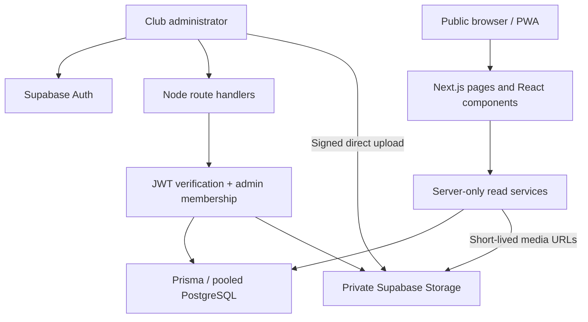
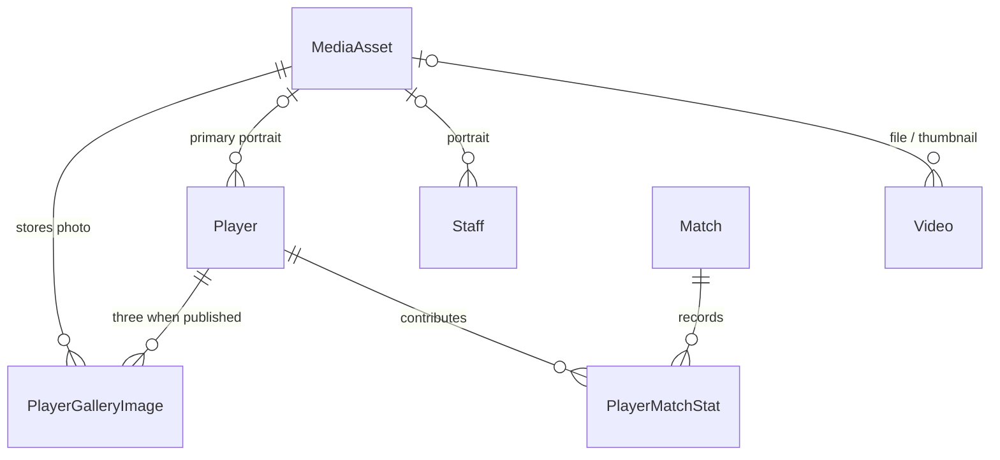

# DRFC — architectural blueprint and implementation guide

Version 0.1.0 · 16 October 2026

## 1. Decision and scope

Use a modular Next.js application with server-rendered public pages, small
interactive React components, Node route handlers and Prisma/PostgreSQL. Keep
Supabase for authentication and private object storage; Supabase can also host
the PostgreSQL database. No separate Express service is needed for the initial
club application. Split services only when independent scaling or ownership
requires it.

This is a runnable starter, not a claim that all production infrastructure is
provisioned. The uploaded Flutter app remains separate. The starter creates a
new `club` database schema; it never targets the existing `public.players`,
`public.matches` or `public.admins` tables.

The Manchester United reference informs the editorial hierarchy, visual
contrast, large headings, media-led sections and club-wide navigation. DRFC
retains its own name, crest, copy and footage. This project contains no Man Utd
logos, photographs or copied editorial content.

## 2. System architecture



**Frontend boundary.** Server components fetch published records and emit only
view-model fields. Client components own menu state, search/filter state,
playback and dialogs. Database clients and service keys are marked server-only.

**Backend boundary.** Each mutation verifies a Supabase bearer token by asking
Auth for the user, then checks `club.Admin`. The browser cannot choose an admin
role or upload object key. Origin checks supplement bearer authentication.
Read routes are published-only; admin writes fail closed when configuration or
membership is missing.

**Data boundary.** Relational records and object identifiers live in PostgreSQL.
Video/image bytes live in object storage. Files go directly from browser to
storage using a server-issued upload token, avoiding request-body buffering of
large media in Next.js.

**Deployment boundary.** Run Next.js in a Node-capable host/container behind
HTTPS and a CDN. Use pooled database connections at runtime and a separate
direct connection for migrations. A static-only host is insufficient for the
implemented authentication and upload handlers.

## 3. File and component hierarchy

```text
prisma/
  schema.prisma
  migrations/202610160001_initial/migration.sql
  migrations/202610160002_invariants/migration.sql
scripts/
  grant-admin.ts
  runtime-role.sql
  storage-setup.sql
src/
  app/
    layout.tsx                 # SiteHeader, content, footer, PWA registration
    page.tsx                   # Cinematic home + asymmetric club features
    squad/page.tsx             # SquadDirectory
    squad/[slug]/page.tsx      # Player hero, vitals, PlayerGallery
    staff/[slug]/page.tsx      # Individual staff profile
    tv/page.tsx                # PageHeading + VideoGrid
    tv/[slug]/page.tsx         # Native video or validated provider iframe
    admin/page.tsx             # AdminVideoStudio
    api/admin/
      uploads/route.ts
      uploads/[id]/complete/route.ts
      videos/route.ts
      players/route.ts
      players/[id]/gallery/route.ts
      players/[id]/publish/route.ts
      staff/route.ts
    club/, news/, matches/, shop/
    manifest.ts, error.tsx, not-found.tsx, globals.css
  components/
    site-header.tsx
    page-heading.tsx
    squad-directory.tsx
    player-gallery.tsx
    video-grid.tsx
    video-player.tsx
    admin-video-studio.tsx
    preview-notice.tsx
    pwa-register.tsx
  lib/
    types.ts, demo.ts
    data.ts                    # Published-only view models
    db.ts                      # Prisma singleton + connection pool
    auth.ts                    # Verified identity + database membership
    validation.ts              # Zod, providers, media signatures
    supabase-server.ts         # Server-only storage and signed read URLs
public/
  images/, players/, videos/, fonts/
  icon.svg, sw.js, offline.html
tests/
  validation.test.ts
  gallery-database.test.ts
  browser/public.spec.ts
```

`RootLayout → SiteHeader + route + footer`. The Squad route nests position
sections and staff department sections inside `SquadDirectory`. Its cards link
to player/staff detail routes. The player detail route nests `PlayerGallery`,
which owns the native dialog and current photo index. The TV route nests
`VideoGrid`, whose items link to the film detail route. The film route chooses
`VideoPlayer` or a canonical YouTube/Vimeo iframe. The admin route composes a
navigation panel, authentication form and video editor.

## 4. Design system

| Token/rule | Implementation |
| --- | --- |
| Primary accent | `--color-devil: #C70101` |
| Canvas | `--color-ink: #0c0c0c` |
| Editorial panels | `--color-panel: #111111` |
| Foreground | White; neutral gray for supporting text |
| Typography | Supplied ClubSans fonts; oversized uppercase headings |
| Surfaces | Sharp edges, no heavy rounded containers |
| Containers | Maximum 1440 px; 16–24 px mobile gutters |
| Motion | Short transforms/opacity transitions; disabled for reduced motion |
| Navigation | Sticky utility tier + main tier + expandable mega-menu |
| Home layout | Cinematic media banner + asymmetric 2:1 editorial grid |

Interactive red buttons use white bold labels. Small accent text is a brighter
red to maintain legibility against dark backgrounds. Essential information
must never depend solely on hover or colour.

### Squad and staff

`Position` is an enum, so grouping does not depend on inconsistent free-text
labels. The UI derives Goalkeepers, Defenders, Midfielders and Forwards from
that enum. `StaffGroup` separately captures Executive, Coaching, Medical and
Kit. A staff member's `role` holds Manager, Assistant coach, Physiotherapist,
Kit manager, etc. Groups and role titles are not conflated with player positions.

Player cards show numbers, names and positions persistently; background numbers
and image scale animate on hover/focus. Staff cards keep names/roles visible
while the background role treatment changes on hover/focus. Mobile users can
read the same content without hovering.

### Player profile and exactly three gallery images

The primary portrait is a separate media relation. The hero supports transparent
PNG/WebP action cutouts using `object-contain`. The supplied photos are JPEGs;
the starter preserves them as supplied and does not claim to have removed their
backgrounds. Upload transparent artwork when available.

The gallery contains three positions, `ONE`, `TWO`, `THREE`. A unique
`(playerId, slot)` key plus the enum prevents a fourth slot. A second unique
`(playerId, assetId)` key prevents the same asset filling multiple slots.
Database constraint triggers require a **published** player to have exactly
three gallery records and prohibit using the primary portrait as a gallery
image. Drafts allow zero to three images so editing is practical.

Gallery replacement runs in a transaction under a player-row lock. The
constraint is deferred until commit, allowing three old records to be replaced
atomically. Deleting a gallery image from a published profile without replacing
it fails at commit. The API also validates three distinct ready image assets,
alt text, captions and the primary-portrait distinction. Byte-level duplicate
image detection is not implemented; different assets can still contain the same
photo and require editorial review.

The client renders exactly three slots. Missing draft/preview assets show
explicit placeholders. Available photos open a lightbox with previous/next,
arrow-key navigation, Escape, focus containment and return-to-trigger behavior
provided by the native dialog. No duplicate photos are fabricated.

### DRFC TV

The name is consistently **DRFC TV**. The core Tailwind rule is:

```tsx
<div className="grid grid-cols-2 gap-x-4 gap-y-9 lg:grid-cols-4 lg:gap-x-6">
  {videos.map(video => <VideoCard key={video.id} video={video} />)}
</div>
```

The actual self-contained card code is in `video-grid.tsx`. Each card includes
16:9 art, a bottom-left play anchor, bottom-right duration, category, title and
short description. This starter loads up to 48 published videos and filters
that loaded set. Before growing beyond that size, add server-side category /
search queries and cursor pagination using the indexed publish-date/id ordering.
The detail route already resolves a published video directly by slug, independent
of the first grid page.

Only one real video was provided. The grid intentionally contains one film in
preview; its CSS still defines four/two columns. Add actual videos through the
configured admin flow to fill the grid.

## 5. Relational model

| Model | Main fields and constraints |
| --- | --- |
| `Player` | UUID, unique slug/number, position enum, biography, nationality, DOB, height, primary portrait, draft/published, optional legacy UUID |
| `PlayerGalleryImage` | Player FK, MediaAsset FK, slot enum, alt/caption; unique player/slot and player/asset |
| `Staff` | UUID, slug, name, department enum, role, biography, portrait, order, publication status |
| `Video` | UUID/slug, title/description/category, upload/YouTube/Vimeo source, provider ID or media FK, thumbnail FK, duration, publication time/status |
| `MediaAsset` | Random object key, MIME, expected size, pending/ready/rejected, creator UUID, timestamp |
| `Admin` | Verified Supabase Auth user UUID; only owner-managed membership |
| `Match` | Opponent, kickoff, venue, competition, season, home, result state and scores, legacy UUID |
| `PlayerMatchStat` | Compound player/match PK; nonnegative goals and assists |



The Prisma schema and migrations are the executable source of truth. Tables
live in `club`; credentials and raw files never live in player JSON columns.
Prisma does not express arbitrary exact-cardinality constraints by itself,
which is why the second SQL migration is essential. Do not replace migrations
with `prisma db push`, which would omit these custom constraints.

The starter retains normalized matches/contributions to support future result
editing. UI totals include completed matches only. Match editing and validation
that contribution totals do not exceed the team score belong in the next
match-management service; that editor is not yet implemented in this React app.

## 6. Admin API and upload workflow

Every endpoint below requires a bearer token resolving to a Supabase user AND a
row in `club.Admin`. There is no demo authentication bypass.

| Method / path | Contract |
| --- | --- |
| `POST /api/admin/uploads` | `{mimeType, bytes}` → `{assetId, bucket, path, token}` |
| `POST /api/admin/uploads/:id/complete` | Verify ownership, existence, size, MIME and file signature; mark READY or REJECTED |
| `GET /api/admin/videos` | Most recent 50 metadata records; no-store |
| `POST /api/admin/videos` | Create draft/published video with ready thumbnail and exactly one video source |
| `GET /api/admin/players` | First 100 player metadata records for future admin UI |
| `POST /api/admin/players` | Create draft player with position, number, bio and optional ready portrait |
| `PUT /api/admin/players/:id/gallery` | Replace the three gallery photos atomically |
| `POST /api/admin/players/:id/publish` | Require primary portrait + three ready additional photos |
| `GET /api/admin/staff` | Bounded staff metadata list |
| `POST /api/admin/staff` | Create a staff draft or published profile |

**Video metadata example** (IDs are returned by completed uploads):

```json
{
  "title": "Training with the Ravens",
  "description": "Inside the latest first-team training session.",
  "category": "TRAINING",
  "durationSeconds": 75,
  "thumbnailId": "<ready image UUID>",
  "assetId": "<ready MP4 UUID>",
  "publish": true
}
```

For an embed, omit `assetId` and supply `embedLink` containing a supported HTTPS
YouTube or Vimeo video URL. The server extracts and validates a provider ID;
arbitrary iframe HTML and arbitrary embed hosts are never accepted. Streams
hosted on YouTube/Vimeo use the same provider route. Arbitrary HLS stream URLs
and private provider access tokens need a separate validated integration.

**Gallery replacement example:**

```json
{
  "photos": [
    {"assetId":"<image UUID 1>","alt":"Player preparing to shoot","caption":"Matchday"},
    {"assetId":"<image UUID 2>","alt":"Player challenging for the ball","caption":"In action"},
    {"assetId":"<image UUID 3>","alt":"Player celebrating with teammates","caption":"Together"}
  ]
}
```

The `photos` order maps to slots ONE/TWO/THREE. Upload caps are 50 MiB for MP4 and
10 MiB for images. Header signatures reject obvious type spoofing; this is not
a full malware scan or codec/quality validation. Duration is editor-provided in
this starter. Add a media-processing worker to derive trusted duration,
dimensions and renditions before large-scale production use.

Signed uploads are minted for randomized, server-selected object keys with
upsert disabled. Completion verifies persisted object metadata, not just the
browser's original size claim. The storage bucket is private. Public page
services sign READY assets referenced by published content for 15 minutes.
Drafts are never exposed by the public read service.

Long-lived tabs can outlast signed URLs; refreshing obtains fresh URLs. For a
larger media service, use a dedicated playback authorization endpoint that
refreshes URLs or a public immutable rendition/CDN layer for approved content.

## 7. Progressive behavior and accessibility

The manifest and service worker provide an installable-app foundation and an
offline navigation fallback. Only the fallback and icon are precached. Admin
pages, tokens, signed media URLs and live database responses are never cached by
the service worker. Offline editing, push notifications and background sync are
not implemented. Add raster install icons and verify platform-specific install
behavior before publishing the PWA.

Native MP4 starts muted only while at least 25% visible. It pauses out of view
or when the browser tab is hidden. Reduced-motion users must choose Play.
Explicit Pause prevents automatic resumption. Full film pages expose native
seek/volume controls. Embedded providers are click-to-play and are not forced
to autoplay. The supplied clip has no audio track.

Keyboard support includes a skip link, visible focus rings, expandable menu
buttons, Escape dismissal, semantic landmarks, labeled fields and a native
lightbox dialog. Provide captions/transcripts for spoken video content before
publication; the starter does not include invented caption tracks.

## 8. Scalability and operations plan

**Initial deployment:** one Next.js service, pooled PostgreSQL, private Supabase
Storage, request-scoped read deduplication and direct-to-storage upload. This
keeps operational cost and complexity proportionate to a club website.

**Growth path:**

1. Add indexed, cursor-paginated public content APIs; filter/search on the server.
   Keep metadata pages small and use background prefetch only on intent.
2. Cache published metadata at the application/CDN layer with explicit
   invalidation on publish. Keep signed-URL expiry shorter than page-cache TTL
   or separate signing from cached metadata; do not cache expired URLs.
3. Move large video ingestion to resumable uploads. Queue jobs for malware
   scanning, ffprobe validation, thumbnail extraction, captions and HLS/DASH
   renditions. Use idempotent jobs and explicit PROCESSING/READY states.
4. Serve immutable processed renditions and responsive image sizes through a
   media CDN. Use `next/image` with an explicit remote-host policy or your image
   transformation service. The starter uses ordinary image elements for local
   and signed assets, so it does not yet implement responsive image delivery.
5. Add editor/publisher/administrator roles, audit records, soft delete, content
   revision history and scheduled publishing. Current starter has one admin role.
6. Add edge rate limits for login/upload/metadata writes, request body limits,
   CSP tailored to provider/media hosts, error monitoring and tracing. Avoid
   placing bearer tokens or signed URLs in logs.
7. Monitor request latency, failed uploads, cache hit rate, DB pool saturation,
   playback failures and migration duration. Define SLOs from measured traffic;
   no throughput numbers are claimed for an unbenchmarked starter.
8. Automate backups, restore drills, migration rehearsals, dependency review and
   browser/API checks in CI. Clean up abandoned PENDING uploads with a scheduled
   retention job. No cleanup job is provisioned by this package.

Scale the Node service horizontally behind a load balancer; keep sessions and
files out of local process memory/disk. Bound Prisma pools per replica and use
a database pooler to avoid exhausting PostgreSQL connections. Add a queue only
when media processing exists, not as an unused architectural dependency.

## 9. Implemented versus extension points

| Included and usable | Requires setup or further implementation |
| --- | --- |
| Public React/Tailwind layouts and navigation | Import of the existing Supabase roster/results |
| Squad/staff grouping and detail pages | Full player/staff editing dashboard (creation/gallery APIs are included) |
| Three-image gallery and DB constraints | Three actual action photos per player, transparent cutout artwork |
| DRFC TV upload/embed form and API | Real Supabase Auth/Storage credentials and admin grant |
| Native clip playback, one real film | More films, captions, transcoding/HLS, trusted duration extraction |
| Match read model and page | Match/result editing UI and import validation |
| News and Shop routes | News CMS and commerce/payment integration |
| Manifest/offline fallback | Offline data, notifications, install testing on target devices |
| Bounded lists and appropriate indexes | Large-library pagination/search and shared caching |

## 10. Primary reference material

- Manchester United reference: https://www.manutd.com/en
- Next.js installation: https://nextjs.org/docs/app/getting-started/installation
- Next.js route handlers: https://nextjs.org/docs/app/getting-started/route-handlers
- Next.js PWA guide: https://nextjs.org/docs/app/guides/progressive-web-apps
- Tailwind PostCSS: https://tailwindcss.com/docs/installation/using-postcss
- Prisma client/config: https://www.prisma.io/docs/orm/prisma-client/setup-and-configuration/instantiate-prisma-client
- Prisma relations: https://www.prisma.io/docs/orm/prisma-schema/data-model/relations/one-to-many-relations
- PostgreSQL constraint triggers: https://www.postgresql.org/docs/current/sql-createtrigger.html
- Supabase verified user: https://supabase.com/docs/reference/javascript/auth-getuser
- Supabase signed uploads: https://supabase.com/docs/reference/javascript/storage-from-createsigneduploadurl

Dependencies are pinned by package-lock.json. The local installed framework
reference is available in node_modules/next/dist/docs after npm ci.
